# Dependency Graph — LuminaAI
> Gerado por auditoria estática completa | Data: 2026-07-15 | Versão do Pipeline: 2.0

---

## Grafo de Dependências do Sistema (Service Architecture)

O diagrama abaixo mapeia as dependências físicas de importação e invocação entre os principais módulos do LuminaAI:

```mermaid
graph TD
    classDef router fill:#fdd,stroke:#333,stroke-width:1px;
    classDef service fill:#dfd,stroke:#333,stroke-width:1px;
    classDef model fill:#ffd,stroke:#333,stroke-width:1px;
    classDef db fill:#bbf,stroke:#333,stroke-width:2px;

    %% Routers (API)
    R_Query["routers/query.py"]:::router
    R_Tenant["routers/tenant.py"]:::router
    R_Catalog["routers/catalog.py"]:::router
    R_Knowledge["routers/business_knowledge.py"]:::router

    %% Services (Business Logic)
    S_Orchestrator["new_query_orchestrator.py"]:::service
    S_Planner["planner_engine.py"]:::service
    S_Optimizer["query_optimizer_engine.py"]:::service
    S_Validator["plan_validator.py"]:::service
    S_Security["security_and_normalization_engine.py"]:::service
    S_Semantic["semantic_layer.py"]:::service
    S_Cache["cache_service.py"]:::service
    S_Sync["sync_service.py"]:::service
    S_SyncEngine["data_platform/sync_engine.py"]:::service
    S_Scheduler["scheduler.py"]:::service

    %% Models
    M_Contracts["models/new_pipeline_contracts.py"]:::model
    M_Tenant["models/tenant.py"]:::model
    M_Catalog["models/view_catalog.py"]:::model

    %% Databases
    DB_Main["luminaai_db (PostgreSQL Metadados)"]:::db
    DB_Clone["luminaai_analytics_db (PostgreSQL Clone)"]:::db
    DB_Oracle["Oracle ERP (Produção)"]:::db

    %% Relações
    R_Query --> S_Orchestrator
    R_Query --> S_Cache
    R_Tenant --> S_Sync
    R_Tenant --> S_Cache
    R_Catalog --> DB_Main
    R_Knowledge --> S_Semantic

    S_Orchestrator --> S_Planner
    S_Orchestrator --> S_Optimizer
    S_Orchestrator --> S_Security
    S_Orchestrator --> DB_Main
    S_Orchestrator --> DB_Clone

    S_Planner --> S_Orchestrator
    S_Planner --> M_Contracts

    S_Optimizer --> M_Contracts
    
    S_Sync --> S_SyncEngine
    S_Sync --> DB_Oracle
    S_Sync --> DB_Clone
    
    S_SyncEngine --> DB_Oracle
    S_SyncEngine --> DB_Clone
    
    S_Scheduler --> S_Sync
    S_Scheduler --> DB_Main
```

---

## 1. Descrição das Cadeias de Dependência

### Cadeia de Consulta Analítica (Read Path)
- `routers/query.py` ──► `new_query_orchestrator.py` ──► `planner_engine.py` ──► `query_optimizer_engine.py` ──► `security_and_normalization_engine.py` ──► `postgresql_clone_service.py` ──► `luminaai_analytics_db`.

### Cadeia de Sincronização (Write Path / ETL)
- `scheduler.py` (ou `routers/tenant.py`) ──► `sync_service.py` ──► `sync_engine.py` ──► `oracle_service.py` (lê do `Oracle ERP`) ──► `postgresql_clone_service.py` (escreve no `luminaai_analytics_db`).

### Cadeia de Governança
- `routers/business_knowledge.py` ──► `business_knowledge_engine.py` ──► `semantic_layer.py` (grava metadados no `luminaai_db`).

---

## ⚠️ ACHADOS CRÍTICOS & RISCOS DE ACOPLAMENTO

1. **Dependência Circular e Acoplamento Bidirecional**:
   - `new_query_orchestrator.py` importa classes de `planner_engine.py` para acionar a árvore de junções BFS.
   - Porém, `planner_engine.py` realiza imports em runtime de componentes e contratos definidos na camada de orquestração para resolver a resposta em caso de replanejamento.
   - **Risco**: Riscos de importação circular em python se não gerenciados com imports locais (in-function imports).

2. **Injeção de Dependência Fraca**:
   - Vários serviços instanciam o `LocalCKGProvider` localmente usando variáveis globais ou instâncias embutidas no construtor (`self.provider = provider or LocalCKGProvider()`), dificultando a escrita de testes mockados isolados para a camada física.

---

*Auditoria estática — nenhum arquivo modificado.*
