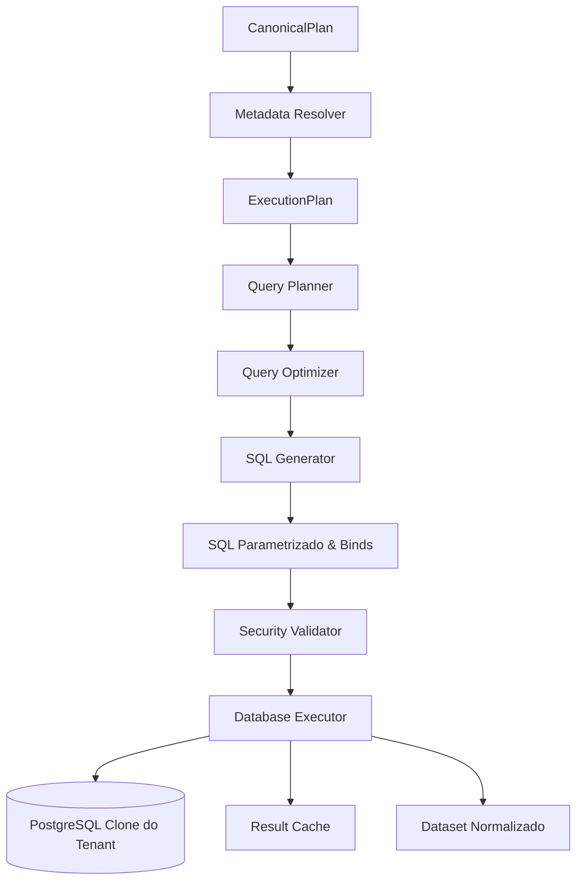

# Metadata Executor Report — LuminaAI
> Gerado por refatoração estática | Data: 2026-07-15 | Versão: 2.0

---

## 1. Arquivos Criados e Modificados

| Arquivo | Ação | Descrição |
|---------|------|-----------|
| **[executor.py](file:///c:/Users/wccto11ti1/Desktop/Sistema%20IA%20Empresa/backend/services/metadata_catalog/executor.py)** | [NEW] | Implementação de `QueryPlanner`, `QueryOptimizer`, `SQLGenerator`, `SecurityValidator` e `DatabaseExecutor`. |
| **[__init__.py](file:///c:/Users/wccto11ti1/Desktop/Sistema%20IA%20Empresa/backend/services/metadata_catalog/__init__.py)** | [MODIFY] | Exportação dos componentes de planejamento e execução física. |
| **[query_optimizer_engine.py](file:///c:/Users/wccto11ti1/Desktop/Sistema%20IA%20Empresa/backend/services/query_optimizer_engine.py)** | [MODIFY] | Redirecionamento das classes `QueryOptimizer` e `SQLGenerator` legadas para as novas implementações dinâmicas baseadas no CKG. |
| **[security_and_normalization_engine.py](file:///c:/Users/wccto11ti1/Desktop/Sistema%20IA%20Empresa/backend/services/security_and_normalization_engine.py)** | [MODIFY] | Redirecionamento de `SecurityValidator` e `ResultNormalizer` legados para as novas implementações, mantendo tratamento de auto-cura. |
| **[new_query_orchestrator.py](file:///c:/Users/wccto11ti1/Desktop/Sistema%20IA%20Empresa/backend/services/new_query_orchestrator.py)** | [MODIFY] | Integração com o novo `database_executor` centralizado para execução física analítica, timeout e auto-cura baseada em empty dataset. |
| **[test_metadata_executor.py](file:///c:/Users/wccto11ti1/Desktop/Sistema%20IA%20Empresa/backend/tests/test_metadata_executor.py)** | [NEW] | Suíte de testes unitários validando planejamento, otimização, injeção de SQL, isolamento de tenant e cache de resultado. |

---

## 2. Arquitetura Implementada

---

## 3. Estratégia de Geração de SQL & Otimizações

- **Compilação Determinística**: O `SQLGenerator` monta as cláusulas `SELECT`, `FROM`, `JOIN`, `WHERE`, `GROUP BY`, `ORDER BY` e `LIMIT` a partir do `ExecutionPlan` físico recebido.
- **Parametrização Estrita**: Todos os filtros utilizam binds nomeados (:param_0, :param_1), eliminando a injeção direta de valores na string.
- **Casts Seguros de JOIN**: Aplicação de casting físico explícito (`::text`) nas colunas participantes da junção, resolvendo incompatibilidades de tipos de dados.
- **Push Down de Filtros**: Os filtros de WHERE são aplicados de imediato para limitar a leitura do banco.
- **Eliminação de JOINs Redundantes**: Se views inseridas no caminho de JOIN do BFS não projetarem colunas ou filtros no SELECT final, o `QueryOptimizer` as remove de forma a baratear o custo computacional no PostgreSQL.

---

## 4. Mecanismos de Segurança e Tenant Isolation

- **Inspeção de Palavras-Chave Proibidas**: O `SecurityValidator` barra DDL/DML de escrita (`DROP`, `ALTER`, `TRUNCATE`, `INSERT`, `UPDATE`, `DELETE`, `UNION`, comandos múltiplos com `;`).
- **Isolamento Físico Obligatório**: Caso o CKG indique que alguma view envolvida na query contém a coluna `tenant_id`, o validador exige de forma estrita que o filtro `tenant_id = :tenant_id` faça parte da cláusula WHERE física, sob risco de interromper imediatamente a execução com falha de segurança analítica.

---

## 5. Política de Cache e Dataset Normalizado

- **Result Cache**: Gerenciamento de cache estruturado em memória indexado pelo hash do `ExecutionPlan` combinado com o `tenant_id` para blindar o acesso a dados de outros inquilinos. TTL de 300 segundos.
- **Normalização de Dados**: Normalização robusta de tipos (Decimal para float, datas/timestamps para strings ISO 8601, substituição de nulos analíticos por `0.0` ou strings vazias).
- **Tratamento de Dataset Vazio**: Se o dataset retornar sem registros e o plano contiver `EMPTY_UNEXPECTED`, o executor altera o status para `NEEDS_REPLANNING` de forma amigável, disparando o loop de auto-cura do orquestrador analítico.

---

## 6. Confirmação de Desacoplamento

> [!IMPORTANT]
> **Confirmação Final de Desacoplamento**: Toda a tradução, otimização, validação e execução física do SQL analítico passou a ser responsabilidade única e exclusiva das novas classes do backend unificadas sob o `DatabaseExecutor` e `SQLGenerator`.
> A IA (Intent Engine) continua 100% livre e desacoplada do domínio físico, gerando apenas planos conceituais semânticos abstratos que são materializados fisicamente de forma segura pelo backend.
