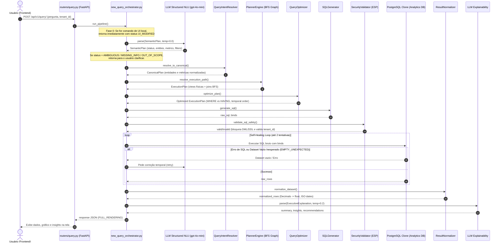

# Current Pipeline — LuminaAI
> Gerado por auditoria estática completa | Data: 2026-07-15 | Versão do Pipeline: 2.0

---

## 1. Mapeamento do Fluxo de Execução

O diagrama abaixo rastreia a trajetória de uma consulta no LuminaAI sob o novo pipeline cognitivo (Decoupled NLU-SQL):

---

## 2. Detalhamento Técnico das Etapas

### Passo 1: Frontend & API Router
- O usuário envia uma pergunta analítica. O endpoint `POST /api/v1/query/` intercepta, enforce o isolamento de tenant conferindo o token JWT do usuário e, se o novo pipeline estiver ativo, chama `new_query_orchestrator.run_pipeline()`.

### Passo 2: LLM Intent Engine (Fase de Entrada)
- A pergunta é processada por um modelo de Structured Outputs (`gpt-4o-mini` por padrão). O LLM é instruído a classificar a intenção e mapear a consulta apenas para entidades lógicas, gerando o `SemanticPlan`.
- Se o LLM detectar ambiguidade insolúvel ou fora de escopo, o pipeline é interrompido aqui para questionar o usuário.

### Passo 3: Query Intent Resolver
- Os aliases semânticos gerados pelo LLM são convertidos em entidades canônicas utilizando o provedor de CKG (`LocalCKGProvider`).

### Passo 4: Planner Engine (Resolução Física)
- Um algoritmo de busca em largura (BFS) mapeia quais views físicas do banco clone são necessárias para a consulta e determina a lista de `INNER JOINs` a serem feitos.

### Passo 5: Query Optimizer & SQL Generator
- **Optimizer**: Separa filtros comuns (WHERE) de agregações (HAVING), ordena filtros temporais e define se usará Common Table Expressions (CTEs).
- **Generator**: Monta a string SQL parametrizada (`$1`, `$2`...) para o driver asyncpg do PostgreSQL.

### Passo 6: Security Validator
- Executa varreduras léxicas e regex contra o SQL para impedir comandos maliciosos e garantir que a cláusula `tenant_id = :tenant_id` esteja injetada na query física de todas as views de dimensão/fatos.

### Passo 7: Self-Healing & Execution Loop
- Conecta-se dinamicamente ao banco PostgreSQL clone do cliente.
- Se o retorno for vazio inesperado, reenvia a query ao LLM relatando o problema (auto-cura) e tenta novamente uma única vez expandindo os filtros.

### Passo 8: Normalização & Explicabilidade
- Trata tipos complexos (`Decimal` para `float`, `None` para valores padrão).
- O dataset é enviado ao LLM de saída (`gpt-4o-mini`) para gerar um resumo executivo, insights e recomendações sem expor termos de banco de dados.

---

## ⚠️ ACHADOS CRÍTICOS & GARGALOS DO PIPELINE ATUAL

1. **Pooling Dinâmico de Conexão no Executor (Passo 7)**:
   > [!CAUTION]
   > O orquestrador abre e destrói o pool do PostgreSQL clone (`create_async_engine` → `engine.dispose()`) **a cada requisição física**. Sob carga alta ou stress test, a criação/destruição constante de pools de conexão causa exaustão de sockets TCP e alta latência no servidor.

2. **Dicionários in-memory sem Persistência (Passo 0/2)**:
   - A governança de estado de conversação e rate limits fica na memória RAM do processo Python. Caso haja workers múltiplos (Uvicorn / Gunicorn), cada requisição pode cair em um processo diferente, quebrando o rastreamento do histórico de conversas e limites de requisição.

---

*Auditoria estática — nenhum arquivo modificado.*
