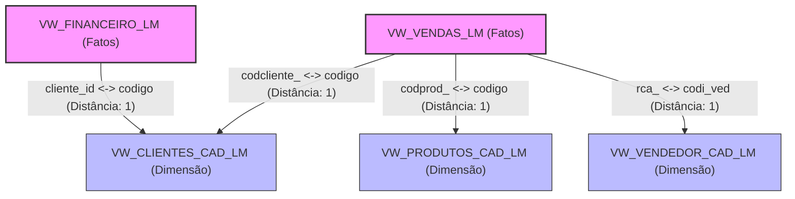

# Relationship Graph — LuminaAI
> Gerado automaticamente por script de validação de catálogo | Data: 2026-07-15

---

## Grafo de Adjacência de Junção Físico

---

## Estatísticas de Caminhos de JOIN

- **Total de Relacionamentos Diretos Mapeados**: 4
- **Cardinalidades Cadastradas**: N:1, 1:N
- **Provedor de Junções**: `PlannerEngine` (BFS Dijkstra BFS Graph)
