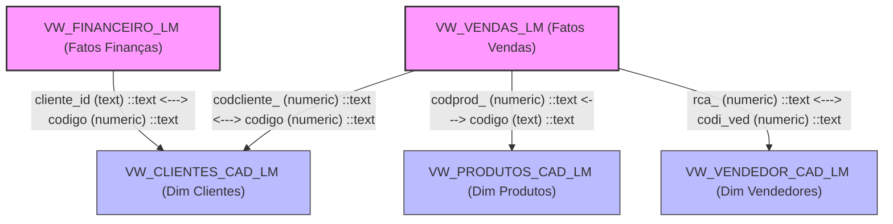

# Relationships Graph — LuminaAI
> Gerado por auditoria estática completa | Data: 2026-07-15 | Versão do Pipeline: 2.0

---

## Grafo de Relacionamento de Banco de Dados Físico

O diagrama abaixo descreve todas as junções físicas possíveis suportadas pelo resolvedor de caminhos (`PlannerEngine` com BFS) no Corporate Knowledge Graph.

---

## 1. Descrição dos Caminhos de Join Físicos

### Caminho 1: Venda ── Cliente
- **Origem**: `VW_VENDAS_LM.codcliente_`
- **Destino**: `VW_CLIENTES_CAD_LM.codigo`
- **Regra de Junção**: `VW_VENDAS_LM.codcliente_::text = VW_CLIENTES_CAD_LM.codigo::text`
- **Finalidade**: Análise de faturamento por cidade, estado (UF) ou nome do cliente.

### Caminho 2: Venda ── Produto
- **Origem**: `VW_VENDAS_LM.codprod_`
- **Destino**: `VW_PRODUTOS_CAD_LM.codigo`
- **Regra de Junção**: `VW_VENDAS_LM.codprod_::text = VW_PRODUTOS_CAD_LM.codigo::text`
- **Finalidade**: Análise de faturamento por família de produto, SKU ou descrição.

### Caminho 3: Venda ── Vendedor
- **Origem**: `VW_VENDAS_LM.rca_`
- **Destino**: `VW_VENDEDOR_CAD_LM.codi_ved`
- **Regra de Junção**: `VW_VENDAS_LM.rca_::text = VW_VENDEDOR_CAD_LM.codi_ved::text`
- **Finalidade**: Análise de performance por vendedor, município do vendedor ou comissão.

### Caminho 4: Financeiro ── Cliente
- **Origem**: `VW_FINANCEIRO_LM.cliente_id`
- **Destino**: `VW_CLIENTES_CAD_LM.codigo`
- **Regra de Junção**: `VW_FINANCEIRO_LM.cliente_id::text = VW_CLIENTES_CAD_LM.codigo::text`
- **Finalidade**: Análise de contas a receber por cliente ou cidade do cliente.

---

## ⚠️ ACHADOS & RISCOS NOS RELACIONAMENTOS DO GRAFO

1. **Desconexão do Grafo Financeiro ── Vendas**:
   > [!IMPORTANT]
   > Não há conexão de junção direta entre `VW_FINANCEIRO_LM` e `VW_VENDAS_LM` declarada no provedor de metadados.
   > Se o usuário fizer uma pergunta que exija métricas financeiras (ex: parcelas em aberto) e dimensões de vendas (ex: faturamento por nota), o BFS falhará e retornará `NEEDS_REPLANNING` ou a query compilará sem junção cruzada direta (gerando produto cartesiano implícito se as duas views forem selecionadas sem caminho).

2. **Tipos de Junção Padrão**:
   - O gerador de SQL (`SQLGenerator.generate_sql`) compila todos os relacionamentos utilizando **`INNER JOIN`**.
   - **Risco**: Se houver transações de vendas com chaves de clientes ou vendedores ausentes temporariamente na base clone (órfãos), essas transações de venda serão **omitidas silenciosamente** dos resultados devido ao comportamento do INNER JOIN.

3. **Casting de Tipo em Execução (`::text`)**:
   - Para resolver discrepâncias de tipo de dados (ex: `codprod_` é numeric, `codigo` em produtos é text), todos os JOINs são forçados com `::text` em ambos os lados da expressão de igualdade.
   - **Gargalo**: O uso de casts explícitos em cláusulas de JOIN anula o uso de índices de chave primária normais no PostgreSQL clone, forçando buscas sequenciais no JOIN em conjuntos de dados muito grandes.

---

*Auditoria estática — nenhum arquivo modificado.*
