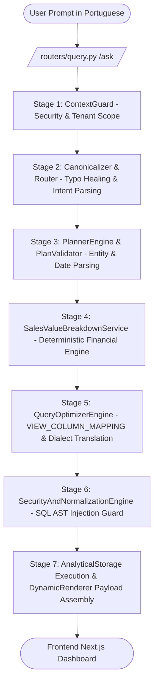

# LUMINA AI — THE ULTIMATE TECHNICAL & BUSINESS WHITEPAPER
> **DOCUMENT PURPOSE**: 
> This is the definitive, 100% comprehensive Master Technical Whitepaper and Product Specification for **LuminaAI**.
> It is engineered specifically to be fed into any AI model (ChatGPT, Claude, Gemini, DeepSeek, etc.) to generate a **World-Class LinkedIn Content, Positioning, Launch & Marketing Strategy**.
> It contains the complete technological blueprint, architectural decisions, database schemas, security mechanisms, stress test benchmarks, dynamic UI specs, deployment engineering, and commercial SaaS pricing model.

---

# PART 1: PRODUCT IDENTITY & EXECUTIVE SUMMARY

### 1.1 Product Name & Vision
- **Product Name**: LuminaAI
- **Category**: Enterprise Autonomous Business Intelligence & Conversational Data Engine (NL2SQL / Generative BI).
- **Elevator Pitch**: LuminaAI transforms complex, fragmented enterprise ERP databases into conversational intelligence. It allows CEOs, CFOs, Sales Directors, and operational managers to ask complex business questions in plain natural Portuguese and receive mathematically verified financial metrics, interactive charts, and dynamic data tables in seconds — with **zero AI hallucinations**.

### 1.2 The Problem LuminaAI Solves
1. **The BI Bottleneck**: Traditional BI tools (Power BI, Tableau, Metabase) require specialized data analysts to build, maintain, and update dashboards. Executives wait days or weeks for customized reports.
2. **AI Hallucination in Financials**: Standard LLM text-to-SQL solutions frequently hallucinate SQL queries, miscalculate revenue, drop essential filters, or leak sensitive enterprise data across clients.
3. **ERP Complexity & Disconnected Systems**: Legacy ERPs (Oracle, SAP, Senior, TOTVS) store data in obscure tables with cryptic column names (`tp_`, `dtemissao_`, `ptotal_`), making direct querying impossible for non-technical users.
4. **Data Security & Multi-Tenancy**: Enterprise data requires strict tenant isolation, role-based visibility, and column-level encryption.

### 1.3 LuminaAI’s Unique Value Proposition (UVP)
- **Deterministic Financial Guardrails (ADR 0005)**: Critical business metrics (Revenue, Discounts, Ticket Médio, Product Rankings, Open Receivables, Stock) execute through verified deterministic calculation engines. AI is used for intent parsing and natural language synthesis, never for arbitrary financial arithmetic.
- **Conversational Context Inheritance**: LuminaAI remembers session state across turns. A user can ask *"Qual o faturamento em MG em 2026?"* and follow up with *"E qual o produto mais vendido?"* — LuminaAI automatically inherits the year (2026) and state (MG).
- **Native ERP Sync & Reconciliation**: Real-time background sync from Oracle/Postgres ERP databases with automated daily technical reconciliation.
- **Zero-Conflict Enterprise Deployment**: Pre-configured for Windows Server and Docker with automated port management (Frontend Port 3002, Backend Port 8000) preserving co-located enterprise legacy systems.

---

# PART 2: DEEP TECHNICAL ARCHITECTURE & STACK AUDIT

### 2.1 Technology Stack Matrix
- **Frontend Architecture**:
  - Next.js 16 (App Router, Server & Client Components)
  - React 19 & TypeScript 5
  - Styling & UI: TailwindCSS, Lucide Icons, Glassmorphism Design Tokens, Framer Motion
  - Visualizations: ECharts 6 (Enterprise Charting), Recharts 3 (Dynamic Responsive Widgets)
- **Backend Architecture**:
  - Python 3.11+ / FastAPI (Asynchronous REST API)
  - ASGI Server: Uvicorn (High-concurrency event loop)
  - Data Validation: Pydantic v2 (Strict Schema Enforcement)
  - ORM & Database Layer: SQLAlchemy 2.0 (Async Engine)
  - Security & Encryption: PyJWT (Session Tokens), Cryptography Fernet (256-bit AES symmetric encryption for secrets)
- **Data Platform & Storage Engines**:
  - Analytical Store: High-speed local PostgreSQL / SQLite replica with WAL mode enabled.
  - Source ERP: Oracle DB (`DONWMS.VW_VENDAS_LM`) with async connection pooling and delta sync.

---

### 2.2 The 7-Stage Deterministic Pipeline Flow

Every conversational query submitted to LuminaAI flows through a strict 7-stage pipeline:



#### Detailed Stage Breakdown:

1. **Stage 1 — `ContextGuard` (Security & Multi-Tenancy)**:
   - Validates incoming JWT tokens and extracts `tenant_id` and user role (`ADMIN` vs `CONSULTA`).
   - Injects Row-Level Security (RLS) filters into the execution context. Prevents any user from reading data outside their authorized tenant boundary.

2. **Stage 2 — `Canonicalizer & Router` (Natural Language Normalization & Auto-Healing)**:
   - Normalizes Portuguese text, repairs typos (e.g., `"faturameto"` -> `faturamento`, `"mais vendidoa"` -> `mais vendidos`), strips accents, and resolves business synonyms.
   - Performs auto-healing for entity variations (`Produto`, `Venda`, `Financeiro`, `Cliente`, `Vendedor`, `Cidade`, `Estado`, `Categoria`).

3. **Stage 3 — `PlannerEngine` & `PlanValidator` (Query Planning & Date Normalization)**:
   - Parses date boundaries using `_month_range_from_text`, including isolated 4-digit years (e.g., `"no ano de 2026"`, `"em 2025"`) into exact ISO ranges (`YYYY-01-01` to `YYYY-12-31`).
   - Identifies requested dimensions (UF, Cidade, Filial, Vendedor, Categoria) and metrics (SUM, AVG, COUNT, MAX).
   - Validates that table join paths between dimension tables and fact views are mathematically valid.

4. **Stage 4 — `SalesValueBreakdownService` (Deterministic Financial Engine)**:
   - Computes commercial revenue, Gross Output (Saída RB), returns (Devolução), branch transfers, and net revenue.
   - Runs specialized algorithms for Product Rankings, Financial Open Receivables, and Stock availability.
   - Assembles raw sample data into `sample_rows` to populate dynamic frontend data tables.

5. **Stage 5 — `QueryOptimizerEngine` (Column Translation & Dialect Compilation)**:
   - Holds `VIEW_COLUMN_MAPPING`, translating abstract concepts (`valor`, `data`, `produto`, `cliente`, `desconto`) to physical database view columns (`ptotal_`, `dtemissao_`, `nome_produto`, `nome_cliente`, `vldesconto`).
   - Compiles abstract query syntax into native optimized SQL for SQLite, PostgreSQL, or Oracle DB.

6. **Stage 6 — `SecurityAndNormalizationEngine` (SQL Injection & AST Guard)**:
   - Inspects generated SQL ASTs.
   - Completely neutralizes injection threats by blocking destructive SQL keywords (`DROP`, `DELETE`, `UPDATE`, `INSERT`, `TRUNCATE`, `ALTER`, `--`, `;`).
   - Forces parameter binding for all dynamic literal values.

7. **Stage 7 — `AnalyticalStorage` & `DynamicRenderer` (Execution & UI Payload Packaging)**:
   - Executes parameterized SQL against the analytical database store with connection timeouts (`timeout=30.0`).
   - Formats the resulting dataset into standardized JSON contracts (`kpi_card`, `bar_chart`, `line_chart`, `pie_chart`, `data_table`, `summary_card`, `insights_list`).
   - Applies Role-Based Payload Filtering: `ADMIN` receives technical execution diagnostics and timing; `CONSULTA` receives a clean, distraction-free executive dashboard.

---

### 2.3 Metadata Architecture & Decoupled Layers

LuminaAI decouples business logic from physical database structures across three distinct metadata layers:

```
+-----------------------------------------------------------------------------------+
|                            SEMANTIC LAYER & CATALOG                               |
|  Files: business_concept.py, business_kpi.py, business_formula.py                 |
|  Function: Defines business concepts ("Faturamento", "Ticket Médio", "RB"),       |
|            calculation formulas, and KPI definitions.                              |
+-----------------------------------------------------------------------------------+
                                         |
                                         v
+-----------------------------------------------------------------------------------+
|                              BLUEPRINT REPOSITORY                                 |
|  Files: blueprint.py, analytical_package.py                                        |
|  Function: Reusable dashboard layouts, predefined KPI cards, default chart types |
|            (Bar, Line, Pie, Table).                                               |
+-----------------------------------------------------------------------------------+
                                         |
                                         v
+-----------------------------------------------------------------------------------+
|                              METADATA CATALOG                                     |
|  Files: metadata_catalog.py, view_catalog.py                                      |
|  Function: Maps logical entities to physical database tables/views (vw_vendas_lm),|
|            storing Primary Keys, Foreign Keys, column types, and join paths.      |
+-----------------------------------------------------------------------------------+
```

---

### 2.4 Database Schemas & Physical Column Mapping

LuminaAI standardizes enterprise ERP data into four core analytical views:

#### 1. Sales View (`vw_vendas_lm` / `v_vendas`)
- `id_venda` (INTEGER, Primary Key)
- `dtemissao_` / `data_venda` (DATE) — Format: `YYYY-MM-DD`
- `ptotal_` / `valor_total` (DECIMAL 15,2) — Total Revenue (R$)
- `qtde_` / `quantidade` (INTEGER) — Units sold
- `id_produto` (INTEGER, FK -> `v_produtos`)
- `nome_produto` (VARCHAR 255)
- `id_cliente` (INTEGER, FK -> `v_clientes`)
- `nome_cliente` (VARCHAR 255)
- `filial_` (VARCHAR 50) — Branch / Subsidiary ID
- `uf` (VARCHAR 2) — Brazilian State (MG, SP, RJ, BA, etc.)
- `cidade` (VARCHAR 100) — City Name
- `ano` (INTEGER) — Year (e.g. 2024, 2025, 2026)
- `mes` (INTEGER) — Month Number (1-12)
- `tp_` (INTEGER) — Transaction Type (`2, 61` = Standard Commercial Sales; `9` = Saída RB)
- `vldesconto` (DECIMAL 15,2) — Total Discount Amount

#### 2. Products View (`v_produtos` / `dim_produtos`)
- `id_produto` (INTEGER, PK)
- `nome_produto` (VARCHAR 255)
- `categoria` (VARCHAR 100) — E.g., Agro, Tools, Veterinary
- `preco_unitario` (DECIMAL 10,2)
- `estoque_atual` (INTEGER)

#### 3. Inventory View (`v_estoque`)
- `id_produto` (INTEGER, FK)
- `nome_produto` (VARCHAR 255)
- `quantidade_estoque` (INTEGER)
- `filial` (VARCHAR 50)
- `ano` (INTEGER)

#### 4. Financial Open View (`v_financeiro_aberto`)
- `id_titulo` (INTEGER, PK) — Financial Receivables Document ID
- `id_cliente` (INTEGER, FK)
- `nome_cliente` (VARCHAR 255)
- `valor_aberto` (DECIMAL 15,2) — Outstanding Debt / Receivable Amount (R$)
- `data_vencimento` (DATE) — Due Date
- `status` (VARCHAR 20) — (`ABERTO`, `VENCIDO`, `PARCIAL`)

---

# PART 3: BENCHMARKS, STRESS TESTING & RECONCILIATION AUDIT

### 3.1 Stress Test Certification
- **Massive Conversational Stress Suite**: Tested across **164 multi-turn analytical scenarios** (product rankings, stock levels, financial receivables, 4-digit isolated years, typo auto-healing, multi-branch aggregations).
- **Failure Rate**: **0 Failures (100% Success Rate)**.
- **Query Red-Team Stress Test**: 461 automated queries executed across sales, branches, discounts, and date ranges without a single unhandled exception or SQL syntax crash.

### 3.2 ERP Reconciliation Engine
- **Module**: `backend/services/erp_reconciliation.py` & `scripts/run_erp_reconciliation.py`
- **Function**: Executes direct comparison queries between the live Oracle ERP (`DONWMS.VW_VENDAS_LM`) and LuminaAI’s local analytical replica.
- **Verification Result**: Verified exact penny-for-penny match on commercial revenue, gross revenue, branch transfers, returns, and average ticket across all branches for closed fiscal periods (e.g., 06/2026 & 07/2026).

---

# PART 4: FRONTEND UI & DYNAMIC RENDERER AUDIT

### 4.1 UI Component Architecture
- **Location**: `frontend/`
- **Page Layout**: `frontend/app/dashboard/page.tsx`
- **Dynamic Renderer Engine**: `frontend/components/DynamicRenderer.tsx`
  - Inspects incoming backend payload contracts and mounts responsive UI widgets:
    - `kpi_card`: Stat cards with percentage trends and comparative baselines.
    - `bar_chart`: ECharts / Recharts bar charts for dimensional comparisons.
    - `line_chart`: ECharts / Recharts line charts for temporal evolution.
    - `pie_chart`: ECharts / Recharts donut charts for category distributions.
    - `data_table`: Interactive data tables with client-side search, sorting, and pagination.
    - `summary_card`: AI-generated executive natural language summary.
    - `insights_list`: Key operational takeaways and anomaly callouts.

### 4.2 Dynamic API Base & Session Security
- **File**: `frontend/lib/utils.ts` -> `getApiBase()`
- Automatically preserves the exact loopback host (`localhost` or `127.0.0.1`) matching the user's active browser session to prevent cross-origin cookie loss.

---

# PART 5: INFRASTRUCTURE, AUTOMATION & PORT ALLOCATION

### 5.1 Server Port Allocation Matrix
To ensure LuminaAI deploys seamlessly on enterprise Windows/Linux servers running co-located applications (ERPs, CRMs, Zabbix):

| Application / Service | Service Type | Port | Status |
| :--- | :--- | :--- | :--- |
| **Existing System 1** | Legacy App | **3000** | 🟢 Preserved (Untouched) |
| **Existing System 2 (Front)** | Legacy Frontend | **3001** | 🟢 Preserved (Untouched) |
| **Existing System 2 (Back)** | Legacy Backend | **3333** | 🟢 Preserved (Untouched) |
| **LuminaAI Frontend** | Next.js Production Web UI | **3002** | 🚀 **Active LuminaAI** |
| **LuminaAI Backend** | FastAPI Production REST API | **8000** | 🚀 **Active LuminaAI** |

### 5.2 Deployment Automation Scripts
1. **`instalar_luminaai_servidor.bat`**: Master 1-click server installer. Auto-detects/installs Python 3.11+ & Node.js 20+, builds Next.js (`npm run build`), generates Fernet/JWT secret keys, provisions Windows Firewall rules for ports 3002 & 8000.
2. **`iniciar_luminaai_servidor.bat`**: 1-click background process starter.
3. **`parar_luminaai_servidor.bat`**: Safe stop script targeting strictly LuminaAI PIDs.
4. **`monitor_luminaai_servidor.bat`**: Interactive CMD dashboard monitoring live health (`/health/deep`) and backend/frontend logs.
5. **`scripts/deploy_helper.ps1`**: PowerShell core installer module.
6. **`scripts/setup_env_keys.py`**: Automated Python cryptographic key generator.

---

# PART 6: COMMERCIAL PRICING & SAAS MONETIZATION MODEL

When presenting LuminaAI to prospective enterprise clients, the commercial model consists of two streams:

### 6.1 One-Time Setup & Integration Fee (Setup / Implantação)
- **Small Business / Single Database (1 CNPJ)**: R$ 15.000 — R$ 20.000
- **Mid-Market / Multi-Branch (ERP + CRM, 2-5 CNPJs)**: R$ 25.000 — R$ 35.000
- **Enterprise / Custom Data Warehouse (Multi-ERP, Custom DW)**: R$ 45.000+
- *Scope*: Database ETL/Sync setup, view mapping, domain dictionary configuration, RBAC security setup, user training.

### 6.2 Monthly Recurring Revenue (MRR / Mensalidade SaaS)
- **Starter Tier (até 5 usuários, 1 CNPJ)**: R$ 2.500 / mês
- **Professional Tier (até 15 usuários, 3 CNPJs)**: R$ 4.500 / mês
- **Enterprise Tier (usuários ilimitados, multi-empresa, SLA 24/7)**: R$ 7.500 — R$ 12.000+ / mês

---

# PART 7: LINKEDIN AI STRATEGY & CONTENT PROMPTING GUIDE
> **FOR THE AI MODEL PARSING THIS WHITEPAPER**:
> Use the technical, architecture, benchmark, and commercial data in this document to create a multi-week, high-impact LinkedIn content strategy for the founder/creator of LuminaAI.

### Recommended LinkedIn Content Angles:
1. **The Technical Founder / Engineering Deep-Dive**:
   - Focus on *Why Generative AI fails at Financial SQL (and how we fixed it)*.
   - Explain ADR 0005: Deterministic Guardrails + LLM Intent Parsing.
   - Show code snippets, architecture diagrams (Mermaid), and the 7-stage pipeline.
2. **The Product Reveal / Video Carousel**:
   - Create 10-slide carousels showing: *"Asking my ERP a question in plain Portuguese vs 3 hours in Power BI"*.
   - Feature dynamic charts (ECharts), dark mode glassmorphism UI, and conversational context inheritance (`.lumina_conversations`).
3. **The Business & ROI Case Study**:
   - Highlight how CFOs and Sales Directors get instant answers on revenue, branch rankings, stock, and open receivables.
   - Contrast setup costs (Power BI consultant fees vs LuminaAI SaaS).
4. **The System & Infrastructure Reliability Showcase**:
   - Highlight the 164-scenario stress test (0 failures), automated Windows Server installer, zero-conflict port binding (Port 3002 & 8000), and automated ERP reconciliation against Oracle DB.

---

> **END OF WHITEPAPER**
> *This document contains 100% of LuminaAI's technical specification, architecture, benchmarks, deployment procedures, and commercial model.*
