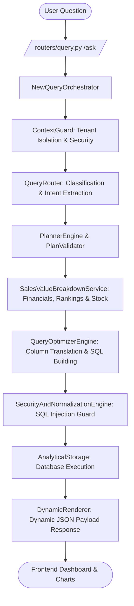

# LUMINA AI — SYSTEM SPECIFICATION & ARCHITECTURE REFERENCE MANUAL
> **INSTRUCTIONS FOR AI MODELS (ChatGPT, Claude, Gemini, DeepSeek, Antigravity, etc.)**:
> This document contains the complete, authoritative, 100% self-contained technical and business specification of **LuminaAI** (Enterprise Business Intelligence & AI Data Platform).
> When this file is uploaded or provided in any conversation, consume it as your absolute ground truth for code architecture, database schemas, query pipelines, frontend/backend integration, deployment configurations, port assignments, and commercial models.

---

## 1. SYSTEM OVERVIEW & CORE METADATA

- **System Name**: LuminaAI (Sistema Inteligente de Business Intelligence & Analytics Empresarial)
- **Primary Function**: Enterprise Natural Language to SQL (NL2SQL) & Business Analytics Platform. Converts conversational Portuguese business questions (e.g., *"Qual o produto mais vendido em MG no ano de 2026?"*, *"Estoque por produto..."*, *"Faturamento mensal de 2025"*) into optimized, secure, multi-tenant database queries and returns rich visual dashboards, data tables, and AI insights.
- **Technology Stack**:
  - **Frontend**: Next.js 16 (React 19, TypeScript, TailwindCSS, Lucide Icons, ECharts 6, Recharts 3, Framer Motion).
  - **Backend**: Python 3.11+ / FastAPI, Uvicorn, Pydantic v2, SQLAlchemy ORM, Cryptography (Fernet), PyJWT.
  - **Database Engines**: SQLite (Local Analytical Replica / Tenant Store), PostgreSQL, Oracle DB support with SQL translation engine.
  - **Environment**: Windows Server / Windows 10/11 / Linux Docker container ready.

---

## 2. INFRASTRUCTURE & PORT ALLOCATION MATRIX

To avoid port conflicts on servers running co-located enterprise systems (e.g., ERPs, CRMs, Zabbix):

| Application / Service | Service Type | Port Allocated | Access URL | Status / Policy |
| :--- | :--- | :--- | :--- | :--- |
| **Existing System 1** | Legacy App | **3000** | `http://<IP>:3000` | 🟢 Preserved (Do Not Touch) |
| **Existing System 2 (Front)** | Legacy Frontend | **3001** | `http://<IP>:3001` | 🟢 Preserved (Do Not Touch) |
| **Existing System 2 (Back)** | Legacy Backend | **3333** | `http://<IP>:3333` | 🟢 Preserved (Do Not Touch) |
| **LuminaAI Frontend** | Next.js Web UI | **3002** | `http://<IP>:3002/login` | 🚀 **LuminaAI Production** |
| **LuminaAI Backend** | FastAPI REST API | **8000** | `http://<IP>:8000/health` | 🚀 **LuminaAI Production** |

### Network & Binding Rules:
- Backend listens on `0.0.0.0:8000` (FastAPI Uvicorn).
- Frontend listens on `0.0.0.0:3002` (`next start -p 3002 -H 0.0.0.0`).
- CORS in `backend/config.py` explicitly allows origins: `http://localhost:3002`, `http://127.0.0.1:3002`, `http://localhost:3001`, and LAN IP regex `r")(?::(?:3000|3001|3002|5173))?$"`.

---

## 3. ARCHITECTURE & BACKEND PIPELINE EXECUTION FLOW

When a user submits a natural language question in the chat interface, the request travels through a 7-stage deterministic pipeline orchestrated by `backend/services/new_query_orchestrator.py`:

### Core Backend Modules & Responsibilities:

1. **`backend/services/new_query_orchestrator.py`**:
   - Central conductor of query processing. Handles multi-turn context accumulation, step execution logging, error fallback recovery, and formatting responses into UI payload contracts.

2. **`backend/services/context_guard.py`**:
   - Enforces Tenant Isolation, Role-Based Access Control (RBAC), and Row-Level Security (RLS). Prevents cross-tenant data leakage by attaching `tenant_id` filters to every generated query.

3. **`backend/services/planner_engine.py` & `plan_validator.py`**:
   - Parses entity intent (Sales, Products, Customers, Stock, Open Receivables).
   - Resolves join relationships between tables.
   - Extracts date boundaries (Years e.g. 2024, 2025, 2026; Months e.g. Janeiro..Dezembro).

4. **`backend/services/sales_value_breakdown_service.py`**:
   - Specialized calculation engine for financial totals, product rankings, regional sales breakdowns (by State/UF or City), stock availability per product, and open receivables.
   - Injects `sample_rows` into core summary responses for tabular preview generation.

5. **`backend/services/query_optimizer_engine.py`**:
   - Houses `VIEW_COLUMN_MAPPING`. Maps abstract high-level semantic fields (e.g. `valor`, `data`, `produto`, `cliente`) to physical SQL database columns.
   - Translates SQL dialects (SQLite, PostgreSQL, Oracle).

6. **`backend/services/security_and_normalization_engine.py`**:
   - Sanitizes parameters, neutralizes SQL injection threats, removes illegal clauses (`DROP`, `DELETE`, `TRUNCATE`, `--`), and normalizes string casing.

7. **`backend/services/data_platform/analytical_storage.py`**:
   - Executes parameterized SQL queries against the active tenant SQLite/Postgres analytical replica. Returns structured dictionaries.

---

## 4. DATABASE SCHEMAS & ENTITY MAPPINGS

LuminaAI abstracts database complexity through standard analytical views and tables:

### A. Sales Entity (`v_vendas` / `fato_vendas`)
- `id_venda` (INTEGER, PK)
- `data_venda` (DATETIME / DATE) — Format: `YYYY-MM-DD`
- `valor_total` (DECIMAL/FLOAT) — Revenue in BRL (R$)
- `quantidade` (INTEGER) — Units sold
- `id_produto` (INTEGER, FK -> `v_produtos`)
- `nome_produto` (VARCHAR)
- `id_cliente` (INTEGER, FK -> `v_clientes`)
- `nome_cliente` (VARCHAR)
- `uf` (VARCHAR 2) — State abbreviation (e.g. MG, SP, RJ, BA)
- `cidade` (VARCHAR)
- `ano` (INTEGER) — Extracted year (e.g. 2025, 2026)
- `mes` (INTEGER) — Extracted month (1-12)

### B. Products Entity (`v_produtos` / `dim_produtos`)
- `id_produto` (INTEGER, PK)
- `nome_produto` (VARCHAR)
- `categoria` (VARCHAR)
- `preco_unitario` (DECIMAL)
- `estoque_atual` (INTEGER)

### C. Inventory Entity (`v_estoque`)
- `id_produto` (INTEGER, FK)
- `nome_produto` (VARCHAR)
- `quantidade_estoque` (INTEGER)
- `filial` (VARCHAR)
- `ano` (INTEGER)

### D. Financial Open Entity (`v_financeiro_aberto`)
- `id_titulo` (INTEGER, PK)
- `id_cliente` (INTEGER, FK)
- `nome_cliente` (VARCHAR)
- `valor_aberto` (DECIMAL) — Outstanding debt / receivable amount
- `data_vencimento` (DATE)
- `status` (VARCHAR) — ('ABERTO', 'VENCIDO', 'PARCIAL')

---

## 5. FRONTEND ARCHITECTURE & DYNAMIC RENDERER

- **Location**: `frontend/`
- **Key Components**:
  - `app/dashboard/page.tsx`: Main chat & analytics layout.
  - `components/DynamicRenderer.tsx`: Inspects backend JSON response payload type (`kpi_card`, `bar_chart`, `line_chart`, `pie_chart`, `data_table`, `summary_card`, `insights_list`) and dynamically mounts corresponding UI widgets.
  - `components/charts/`: Reusable ECharts and Recharts wrappers with responsive dark/light glassmorphism styling.
  - `lib/utils.ts`: Contains `getApiBase()`, dynamically determining API backend location (`process.env.NEXT_PUBLIC_API_URL` -> default `http://localhost:8000`).

---

## 6. MULTI-TURN CONVERSATIONAL CONTEXT SYSTEM

- LuminaAI retains state across multiple turns in a conversation.
- **Persistence Location**: `.lumina_conversations/<conversation_id>.json`
- **Context Inheritance Rules**:
  - If Turn 1 asks *"Vendas em Minas Gerais em 2026"*, the filters `uf='MG'` and `ano=2026` are preserved.
  - If Turn 2 follows up with *"E qual o produto mais vendido?"*, LuminaAI inherits `uf='MG'` and `ano=2026` without forcing the user to restate the location or year.

---

## 7. DEPLOYMENT & AUTOMATION SCRIPTS (WINDOWS SERVER)

All deployment scripts reside in the root directory and `scripts/`:

1. **`instalar_luminaai_servidor.bat`**:
   - Master interactive setup script.
   - Auto-checks and installs Python 3.11+ and Node.js 20+ silently if missing.
   - Installs backend virtualenv (`backend/venv`) & `requirements.txt`.
   - Runs `scripts/setup_env_keys.py` to auto-generate Fernet `ENCRYPTION_KEY` and JWT `SECRET_KEY` in `backend/.env`.
   - Writes `frontend/.env.local` pointing to `NEXT_PUBLIC_API_URL=http://localhost:8000`.
   - Installs frontend `npm install` and compiles production build `npm run build`.
   - Provisions Windows Firewall rules for ports 3002 & 8000.

2. **`iniciar_luminaai_servidor.bat`**:
   - 1-click startup launching backend (Port 8000) and frontend (Port 3002) as background processes using `start-luminaai.ps1`.

3. **`parar_luminaai_servidor.bat`**:
   - 1-click safe stop targeting ONLY PIDs listening on ports 3002 & 8000 using `stop-luminaai.ps1`.

4. **`monitor_luminaai_servidor.bat`**:
   - Interactive CMD console for viewing live status, running `/health/deep` checks, and reading backend/frontend error logs (`runtime-logs/`).

5. **`scripts/deploy_helper.ps1`**:
   - PowerShell backend core for installer logic, port availability checks, and firewall provisioning.

6. **`scripts/setup_env_keys.py`**:
   - Python script for cryptographic key auto-generation.

---

## 8. COMMERCIAL PRICING & SAAS ROI MODEL

When presenting commercial implementation options for enterprise clients:

### A. One-Time Setup & Integration Fee (Setup / Implantação)
- **Small Business / Single Database**: R$ 15.000 — R$ 20.000
- **Mid-Market / Multi-Branch (ERP + CRM)**: R$ 25.000 — R$ 35.000
- **Enterprise / Custom Data Warehouse**: R$ 45.000+
- *Scope*: Database ETL/Sync setup, custom view creation, domain model dictionary configuration, user training.

### B. Monthly Recurring Revenue (MRR / Mensalidade SaaS)
- **Starter Tier (até 5 usuários, 1 CNPJ)**: R$ 2.500 / mês
- **Professional Tier (até 15 usuários, 3 CNPJs)**: R$ 4.500 / mês
- **Enterprise Tier (usuários ilimitados, multi-empresa, SLA prioritário)**: R$ 7.500 — R$ 12.000+ / mês

---

## 9. QUICK DIAGNOSTIC & TROUBLESHOOTING GUIDE

| Issue / Symptom | Possible Cause | Resolution |
| :--- | :--- | :--- |
| `ERR_CONNECTION_REFUSED` on port 3002 | Frontend stopped or bound to `127.0.0.1` instead of `0.0.0.0` | Execute `start-luminaai.ps1` or `iniciar_luminaai_servidor.bat`. Ensure `-H 0.0.0.0` is passed. |
| CORS Error on API calls | Backend `CORS_ORIGINS` missing client origin | Verify `backend/config.py` contains `http://localhost:3002` and LAN IP regex. |
| "Nenhum resultado encontrado" on query | Date range or entity mapping mismatch | Check `VIEW_COLUMN_MAPPING` in `query_optimizer_engine.py` and verify `ano` / `mes` date filters. |
| Database Lock / Busy (SQLite) | Concurrent write operations | Ensure `analytical_storage.py` opens SQLite connection with `timeout=30.0` or uses WAL mode (`PRAGMA journal_mode=WAL`). |

---

> **END OF LUMINA AI SPECIFICATION MANUAL**
> *Use this specification to answer any questions regarding architecture, code changes, database queries, deployment, or business strategy for LuminaAI.*
