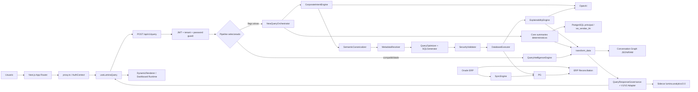
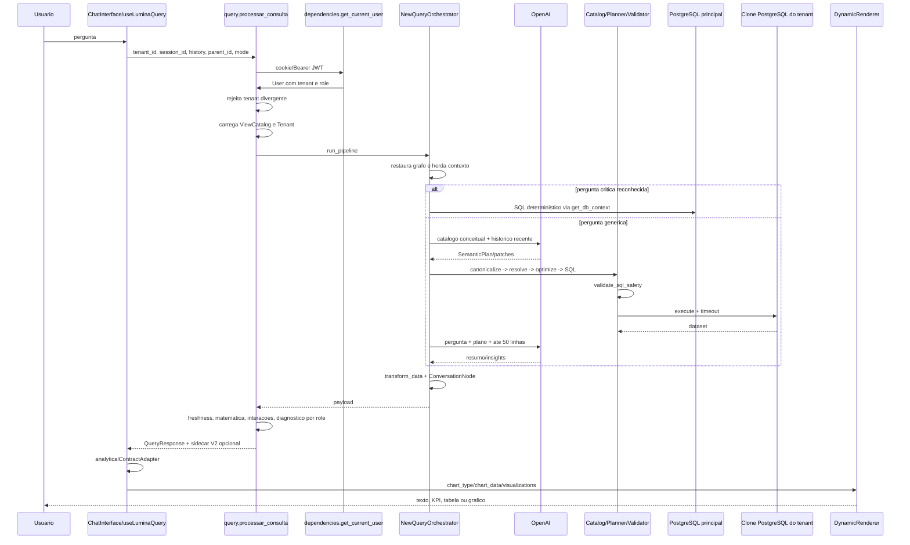
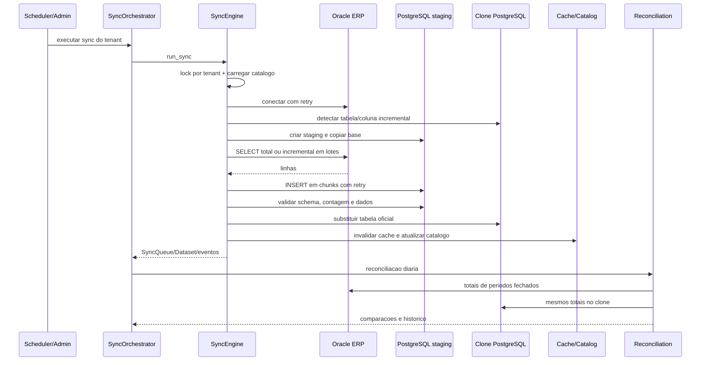
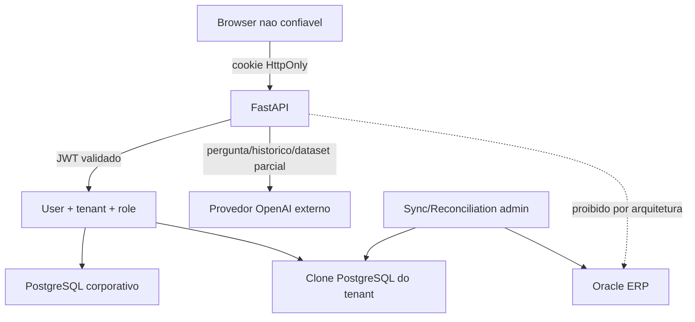

# Arquitetura As-Is - LuminaAI

Data: 2026-07-27.

Este documento descreve o codigo existente. Termos como "confirmado" significam
evidencia estatica; comportamento dependente de banco/servicos esta marcado.

## 1. Diagrama de componentes

Evidencias principais:

- `backend/main.py`
- `backend/routers/query.py:187`
- `backend/services/new_query_orchestrator.py:2251`
- `backend/services/query_intelligence_engine.py:1436`
- `backend/services/metadata_catalog/`
- `frontend/hooks/useLuminaQuery.ts`
- `frontend/components/DynamicRenderer.tsx`

## 2. Fluxo de consulta real

Desde o Prompt 03, `backend/contracts/analytical_v2/` e a representacao
canonica versionada. O payload V1 permanece como superficie compativel e a
governanca pode gerar o sidecar V2 em modo shadow ou exposto por feature flag.

### 2.1 Passos e simbolos

1. Envio: `ChatInterface` chama `useLuminaQuery.submitQuery`.
2. Requisicao: `frontend/hooks/useLuminaQuery.ts:648-668`.
3. API: `backend/routers/query.py:187`.
4. Auth/tenant: `routers/dependencies.py:get_current_user`; comparacao na linha
   202 do router.
5. Contexto: history do frontend e
   `metadata_catalog/conversation_graph.py:get_graph`.
6. Normalizacao: helpers no orquestrador e canonicalizer.
7. Intencao: caminho deterministico ou
   `CorporateIntentEngine.analyze_query`.
8. Metricas/filtros: `SemanticPlan` e catalogo corporativo.
9. Datas: helpers do orquestrador, intent/planner e SQLGenerator.
10. Plano: `MetadataResolver.resolve`.
11. Validacao conceitual/fisica: canonicalizer/resolver e
    `SecurityValidator.validate_sql_safety`.
12. SQL/executor: `SQLGenerator.generate_sql` e
    `DatabaseExecutor.execute_query`.
13. Execucao: clone PostgreSQL por tenant.
14. Transformacao: normalizer, explainability, `transform_data`.
15. Payload: `final_payload` e `QueryResponseGovernance.enrich`.
16. Estado frontend: mensagens, graph e `lastResponse`.
17. Render: `AssistantResponseBlock`, `DynamicRenderer` e runtime.
18. Persistencia: Conversation Graph JSON e historico PostgreSQL.

### 2.2 Pontos de perda ou mutacao

- History e truncado para seis mensagens no intent engine.
- Heranca textual pode adicionar periodo/metrica/dimensao/filial.
- Patches de continuidade reconstroem filtros sobre um `last_plan` que remove
  filtros do node ativo antes de enviar a IA.
- Falha do intent engine produz plano de Cliente.
- "Auto-cura" pode promover MISSING/UNSUPPORTED para READY.
- Plano e SQL podem ser regenerados uma vez apos dataset vazio.
- Explainability pode formular comparacoes em texto; validacao matematica
  posterior cobre apenas contratos reconhecidos, nao toda frase livre.
- O pipeline legado possui fluxo e fallbacks diferentes.

## 3. Fluxo de sincronizacao

Confirmado por:

- `backend/services/scheduler.py`
- `backend/services/data_platform/sync_scheduler.py`
- `backend/services/data_platform/sync_engine.py`
- `backend/services/daily_reconciliation.py`
- `backend/services/erp_reconciliation.py`

## 4. Mapa backend

| Camada | Implementacao real | Responsabilidade |
| --- | --- | --- |
| HTTP | `backend/main.py`, `routers/` | API, middleware, auth e RBAC |
| Contratos | `schemas/`, `models/new_pipeline_contracts.py` | DTOs HTTP e pipeline |
| Orquestracao | `new_query_orchestrator.py`, `query_intelligence_engine.py` | pipelines novo/legado |
| IA | `services/ai/`, `metadata_catalog/intent_engine.py` | intencao e explicacao |
| Semantica | `semantic_layer.py`, `metadata_catalog/canonicalizer.py` | aliases e conceitos |
| Planejamento | `query_planner.py`, `metadata_catalog/resolver.py` | selecao de fonte/plano |
| SQL | `metadata_catalog/executor.py` | optimize, generate, validate, execute |
| Negocio | `services/business/`, `metric_registry.py` | KPIs, formulas e regras |
| Dados | `data_platform/`, `postgresql_clone_service.py` | storage, packages, runtime |
| ERP | `oracle_service.py`, sync/reconciliation | origem tecnica |
| Governanca | `query_response_governance.py`, audit engines | validacao e diagnostico |
| Estado | Conversation Graph, SearchHistory, SemanticMemory | conversa e memoria |
| Operacao | scheduler, health, cache, performance/security | runtime |

## 5. Mapa frontend

| Area | Caminho | Estado |
| --- | --- | --- |
| Shell/rotas | `frontend/app/` | implementado |
| Login/sessao | `context/AuthContext.tsx` | cookie HttpOnly + session endpoint |
| Guarda de rota | `frontend/proxy.ts` | role/exp/first access, sem validar assinatura |
| Chat | `components/chat/ChatInterface.tsx` | implementado |
| Estado query | `hooks/useLuminaQuery.ts` | hooks locais, session/history/parent |
| Renderer | `components/DynamicRenderer.tsx` | ECharts e tabela |
| Runtime | `components/dashboard-runtime/` | grid, trust center e adaptacao |
| Studio | `app/dashboard/studio` | templates/instancias |
| Interacao | `components/interaction-engine/` | cross-filter/fullscreen |
| Preferencias | API + localStorage | parcial/duplicado |
| Testes | `tests/visual/enterprise-layout.spec.ts` | visual mockado |

Nao ha React Query, SWR, Redux ou outro cache global de servidor confirmado.

## 6. Componentes tecnicos e contratos

| Componente/simbolo | Chamado por | Chama/depende | Entrada -> saida | Estado/testes/riscos |
| --- | --- | --- | --- | --- |
| `query.processar_consulta` | HTTP frontend | auth, catalogo, pipeline, governance | QueryRequest -> QueryResponse | ativo; testes query; dois pipelines |
| `get_current_user` | routers protegidos | JWT, User, DB | token/cookie -> User | ativo; auth/security; depende de tenant no token |
| `NewQueryOrchestrator.run_pipeline` | query router | graph, intent, metadata, executor | texto/contexto -> payload | ativo por flag; muitos testes; bloco duplicado |
| `_execute_core_summary_query` | orquestrador | sales breakdown, DB principal | pergunta/periodo -> rows/payload | ativo; testes focados; tenant nao filtrado |
| `QueryIntelligenceEngine.process_query` | query router legado | engines AI/data platform | payload/catalogo -> response | compatibilidade; ampla suite; complexidade alta |
| `ContextGuard` functions | fluxo legado | regex/allowlists | texto/params -> sanitizado/erro | implementado; risco de cobertura desigual |
| `CorporateIntentEngine.analyze_query` | orquestrador | OpenAI/catalogo | pergunta/history -> SemanticPlan | ativo; structured output; fallback Cliente |
| `SemanticCanonicalizer.canonicalize` | orquestrador | catalogo corporativo | SemanticPlan -> CanonicalPlan | ativo; testes canonicalizer |
| `MetadataResolver.resolve` | orquestrador | grafo do catalogo | CanonicalPlan -> ExecutionPlan | ativo; timeout HTTP de metadados em partes |
| `QueryOptimizer.optimize_plan` | orquestrador | ExecutionPlan | plan -> optimized plan | ativo; cobertura indireta |
| `SQLGenerator.generate_sql` | orquestrador | metadados fisicos | ExecutionPlan -> SQL/binds | ativo; identificadores interpolados |
| `SecurityValidator.validate_sql_safety` | orquestrador | catalogo/regex | SQL/tenant -> bool/erro | ativo; lexical, nao parser |
| `DatabaseExecutor.execute_query` | orquestrador | clone PostgreSQL | plan/SQL/binds -> dataset | ativo; cache/timeout; EXPLAIN ANALYZE duplica execucao |
| `SalesValueBreakdownService` | core summaries/reconciliation | `vw_vendas_lm` | periodo/filial -> totais/rankings | ativo; testes sales; sem tenant no SQL |
| `QueryResponseGovernance.enrich` | query router | metadata/sync/math | payload/user -> payload governado | ativo; testes proprios |
| `AnalyticalStorage.execute_view` | fallbacks/data platform | clone/mock local | view/params -> rows | ativo; mock/fallback condicionais |
| `BlueprintRepository` | QIE/packages | models/catalogo | blueprint -> versoes/uso | ativo; testes enterprise |
| `AnalyticalPackageService` | package router/QIE | models/runtime | plano/payload -> package | ativo; write deprecate sem role forte |
| `DashboardStudioService` | studio router | templates/instances/versions | layouts -> DTOs | ativo; testes; visual-only guard |
| `SyncEngine.run_sync` | sync orchestrator | Oracle, staging, clone | tenant/job -> SyncQueue/eventos | ativo; testes existem, nao executados |
| `DailyReconciliationService` | scheduler | Oracle + clone reports | tenant -> summary/history | ativo; requer Oracle em runtime |
| `IntelligentCachingPlatform` | pipelines/data platform | RAM | tenant/namespace/key -> valor | ativo; testes cache; nao distribuido |
| `ConversationGraphManager` | orquestrador | RAM/JSON | session/node -> graph | ativo; testes graph; nao distribuido |
| `DynamicRenderer` | response block/runtime | ECharts/DataTable | chart contract -> UI | ativo; type/build passam |
| `useLuminaQuery` | dashboard/chat | fetch/auth/local state | pergunta -> mensagens/graph | ativo; sem teste unitario dedicado |

## 7. Mapa de persistencia

| Dado | Persistencia | Escopo |
| --- | --- | --- |
| Tenant/usuario | PostgreSQL corporativo | tenant |
| Catalogos/KPIs/formulas | PostgreSQL corporativo | tenant |
| Blueprints/packages/dashboards | PostgreSQL corporativo | tenant/usuario |
| Search history | PostgreSQL corporativo | usuario |
| Semantic memory | PostgreSQL corporativo | tenant |
| Conversation Graph | JSON local + RAM | session_id |
| Cache global | RAM do processo | tenant/namespace |
| Cache executor | RAM do processo | plan + tenant |
| Dados ERP sincronizados | clone PostgreSQL | banco por tenant/config |
| Logs/debug | filesystem | processo/host |

## 8. Fronteiras de seguranca

Controles confirmados:

- tenant no JWT e consulta do usuario;
- comparacao tenant payload/usuario;
- filtros por tenant em repositorios;
- chave de cache inclui tenant nos caches centrais;
- SQL bloqueia DML/DDL/UNION/semicolon;
- valores usam binds;
- roles para rotas administrativas principais;
- password-change guard.

Lacunas:

- RLS PostgreSQL nativo nao confirmado;
- core summaries consultam `vw_vendas_lm` pela conexao corporativa principal e
  nao adicionam filtro `tenant_id`; isolamento fisico dessa view nao foi
  confirmado;
- dados reais podem sair para OpenAI;
- identificadores SQL sao interpolados;
- clone usa banco derivado da configuracao do tenant, mas as credenciais base
  vem da `DATABASE_URL`;
- alguns endpoints mutaveis de governanca nao exigem role;
- proxy frontend apenas decodifica o JWT;
- logs/debug podem persistir SQL, binds e amostras.

## 9. IA, validacao e numeros

### Chamadas

1. Intent: estrutura `SemanticPlan`; nao deve produzir SQL.
2. Explainability: transforma dataset em resumo/insights.
3. Engines legadas: intencao, analise executiva e componentes.
4. Self-healing: nova interpretacao apos falha/dataset vazio.

### Validacoes

- Pydantic Structured Outputs.
- Canonicalizer e metadata resolver.
- SQL keyword/tenant validator.
- Timeout PostgreSQL.
- Normalizacao de tipos.
- `QueryResponseGovernance.validate_math`.
- Reconciliacao ERP/clone fora do caminho interativo.

Nao confirmado:

- validacao de toda afirmacao numerica escrita pela IA;
- mascaramento de PII antes da explicabilidade;
- budget global de tokens por tenant/usuario;
- testes de prompt injection com dados reais.

## 10. Pontos parcialmente implementados

- Estado conversacional duravel/distribuido.
- RLS nativo.
- CI/CD.
- Migrations transacionais centralizadas.
- Cache distribuido.
- Observabilidade central (traces/metricas existem localmente).
- Politica de privacidade para prompts/datasets.
- Separacao definitiva entre pipeline novo e legado.
- Ambiente de testes isolado.
- Lint frontend verde.
- Porta operacional unica entre todos os modos.

## 11. Dependencias criticas

- API depende do PostgreSQL corporativo no startup.
- Pipeline generico depende de credencial OpenAI valida.
- Consulta depende do clone configurado para o tenant.
- Core summaries dependem de `vw_vendas_lm` e contratos relacionados.
- Sync depende de Oracle, clone e ViewCatalog.
- Dashboard depende do contrato `QueryResponse` e adaptador legado.
- Multiworker aumenta risco para caches/grafos locais.
