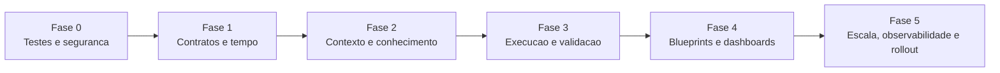

# Mapa De Implementacao LuminaAI V2

Data: 2026-07-28.

Este documento registra as etapas V2 concluidas e prepara as evolucoes futuras.

## 1. Principios de rollout

1. Isolar testes e obter baseline antes de codigo funcional.
2. Fixar contratos, metricas e proveniencia antes de ampliar IA/UI.
3. Manter pipeline legado ate paridade mensuravel.
4. Consultas usam apenas clone PostgreSQL.
5. Oracle permanece em sync/reconciliacao tecnica.
6. Toda fase exige tenant, RBAC, rollback e observabilidade.
7. Migracoes devem ser explicitas; remover `create_all` do startup somente apos
   ferramenta de migration e rollout seguros.

## 2. Ordem recomendada

## 3. Frentes V2

### Fase 0 - Linha de base

#### 1. Ambiente de testes e linha de base

- Reutilizar: `backend/tests/`, `pytest.ini`, Playwright, scripts red team.
- Alterar: `backend/tests/conftest.py`, `backend/reset_test_state.py`,
  documentacao e configuracao de teste.
- Novos: `backend/config_test.py` ou fixture de settings, compose de teste,
  guard de DATABASE_URL, dataset seed imutavel.
- Dependencias: PostgreSQL descartavel e mock OpenAI/Oracle.
- Riscos: apagar dados reais; teste passar por compartilhar estado.
- Pre-requisitos: banco com nome/host allowlisted e credenciais sem producao.
- Testes: guard anti-producao, isolamento por teste, tenant A/B, rollback.
- Compatibilidade: nenhum teste atual deve apontar para banco operacional.
- Ordem: primeira entrega obrigatoria.

Seguranca imediata do repositorio integra esta primeira frente:

- Reutilizar: `.gitignore`, criptografia em `oracle_service.py`.
- Alterar: processo Git e scripts de logging.
- Novos: politica de segredos, scanner CI e runbook de rotacao.
- Dependencias: rotacao externa das credenciais encontradas.
- Riscos: invalidar ambientes ao remover segredo sem rotacao.
- Pre-requisitos: inventario com proprietario de cada segredo.
- Testes: secret scan e garantia de logs sem credenciais.
- Compatibilidade: manter nomes de variaveis, nunca valores.
- Ordem: paralela ao ambiente de testes.

### Fase 1 - Contratos e comparacoes

Estado em 2026-07-28: contratos, normalizador temporal, planner, executor e
apresentacao comparativa foram implementados e documentados. A camada
`lumina.comparison-presentation/1.0` permanece atras de feature flag com
fallback V1 e shadow estrutural.

#### 2. Contratos analiticos V2

**Estado em 2026-07-27: concluido no Prompt 03.**

- Reutilizar: `models/new_pipeline_contracts.py`, `schemas/query.py`.
- Alterar: contratos, orquestrador, frontend `types/lumina.ts`.
- Implementado: `backend/contracts/analytical_v2/`, adaptadores V1/V2, sidecar,
  shadow mode, schemas, goldens e adaptador frontend.
- Dependencias: registro de metricas e politica de compatibilidade.
- Riscos: quebrar adaptador/pipeline legado.
- Pre-requisitos: golden payloads dos dois pipelines.
- Testes: serializacao V1/V2, schema OpenAPI e consumer tests.
- Compatibilidade: adaptador V1 -> V2 durante rollout.
- Ordem: apos baseline.
- Evidencia: `docs/audit/PROMPT_03_CONTRACTS_V2_REPORT.md`.

#### 3. Normalizador temporal universal

**Estado em 2026-07-27: concluido no Prompt 04.**

- Implementado: `backend/services/temporal/`, contexto e relogio injetaveis,
  adapters, rollout, corpus e observabilidade sanitizada.
- Dependencias: timezone do tenant e calendario fiscal.
- Riscos: intervalos inclusivos e datas relativas divergentes.
- Pre-requisitos: contrato Period V2.
- Testes: meses, anos, semestres, comparacoes, leap year, ambiguidades.
- Compatibilidade: manter binds `data_inicio/data_fim`.
- Ordem: antes do planner comparativo.

#### 4. Planner generico de comparacoes

**Estado em 2026-07-27: concluido no Prompt 05.**

- Implementado: `backend/services/comparison_planning/`, providers
  governados, modelos estritos, builder de operandos, filtros, alinhamento,
  complexidade, adapters, feature flags, shadow mode e golden plans.
- Dependencias: normalizador temporal e metric registry.
- Riscos: segundo periodo sobrescrever o primeiro.
- Pre-requisitos: Period V2.
- Testes: periodo, entidade, metrica, meta, N operandos, filtros, seguranca,
  multitenancy, propriedades, rollout e compatibilidade.
- Compatibilidade: converter planos simples atuais.
- Ordem: concluido apos o normalizador temporal.
- Evidencia: `docs/audit/PROMPT_05_COMPARISON_PLANNER_REPORT.md`.

#### 5. Executor universal de comparacoes

**Estado em 2026-07-28: concluido no Prompt 06.**

- Implementado: `backend/services/comparison_execution/`, catalogo governado,
  compilador parametrizado, grafo, runners, alinhamento, calculos `Decimal`,
  validacao, proveniencia, cache local opt-in, adapters e runtime.
- Dependencias: planner comparativo e fontes deterministicas.
- Riscos residuais: fonte sem `tenant_id`, meta nao cadastrada, custo e rollout
  prematuro.
- Pre-requisitos: query budget/timeout e dataset teste.
- Testes: 233 dedicados sem xfail, incluindo PostgreSQL descartavel,
  denominador zero, filtros, budgets, timeout, SQL e multitenancy.
- Compatibilidade: AnalyticalResponseV2, adaptador V1 e sidecar sem reexecucao.
- Ordem: concluido apos o planner; flags de producao permanecem desligadas.
- Evidencia: `docs/audit/PROMPT_06_COMPARISON_EXECUTOR_REPORT.md`.

#### 6. Renderizacao comparativa

- Reutilizar: `DynamicRenderer.tsx`, ECharts e runtime.
- Alterar: tipos, renderer e `AssistantResponseBlock`.
- Novos: componentes comparison KPI/table/chart.
- Dependencias: payload V2.
- Riscos: escalas enganosas e labels sobrepostos.
- Pre-requisitos: contrato visual comparativo.
- Testes: unitarios, screenshots e acessibilidade.
- Compatibilidade: fallback TABLE.
- Ordem: apos executor.

### Fase 2 - Contexto e conhecimento

#### 7. Estado conversacional no PostgreSQL

- Reutilizar: ConversationGraph contracts, SearchHistory e SemanticMemory.
- Alterar: orquestrador e manager do grafo.
- Novos: models/repository de conversation sessions/nodes e migration.
- Dependencias: migration framework, TTL e criptografia.
- Riscos: PII, crescimento e concorrencia.
- Pre-requisitos: tenant/user/session key formal.
- Testes: concorrencia, retomada, expiracao e cross-tenant.
- Compatibilidade: import opcional dos JSON atuais.
- Ordem: depois do baseline/migrations.

#### 8. Heranca e resolucao de contexto

- Reutilizar: `_question_with_inherited_context`, SemanticPatch.
- Alterar: intent engine, orchestrator e contracts.
- Novos: `services/context_resolution_engine.py`.
- Dependencias: estado conversacional persistente.
- Riscos: filtros invisiveis e mudanca de assunto.
- Pre-requisitos: proveniencia por campo.
- Testes: 10+ turns, reset, contradicao e backtracking.
- Compatibilidade: historico textual como fallback.
- Ordem: apos 8.

#### 9. Base de conhecimento empresarial

- Reutilizar: `services/business/`, models business_* e BKE router.
- Alterar: RBAC das rotas e versionamento.
- Novos: approval workflow e ownership.
- Dependencias: roles/permissoes granulares.
- Riscos: usuario comum alterar formula oficial.
- Pre-requisitos: fechar lacuna RBAC.
- Testes: CRUD por role, version/rollback e tenant.
- Compatibilidade: manter aliases atuais.
- Ordem: antes de aprendizado automatico.

#### 10. Perfil e memoria do usuario

- Reutilizar: DashboardPreference, SemanticMemory.
- Alterar: preferences API, query context e frontend.
- Novos: model UserAnalyticalProfile.
- Dependencias: consentimento, retention e tenant/user scope.
- Riscos: personalizacao contaminar verdade empresarial.
- Pre-requisitos: separar preferencia de regra de negocio.
- Testes: defaults, opt-out, reset e isolamento.
- Compatibilidade: importar preferencias atuais.
- Ordem: apos estado conversacional.

#### 11. Feedback e aprendizado supervisionado

- Reutilizar: historico, audit logs e blueprint usage.
- Alterar: resposta/frontend e repositories.
- Novos: feedback model, moderation queue e training export seguro.
- Dependencias: privacidade e processo humano.
- Riscos: poisoning e uso indevido de PII.
- Pre-requisitos: governanca do conhecimento.
- Testes: role, tenant, auditabilidade e rejeicao de poison.
- Compatibilidade: sem autoaplicar feedback no inicio.
- Ordem: apos 10 e 11.

#### 12. Recuperacao semantica

- Reutilizar: aliases, semantic memory e fingerprint.
- Alterar: canonicalizer/intent.
- Novos: retrieval service e indice escolhido.
- Dependencias: embeddings/provider e politica de dados.
- Riscos: custo, vazamento entre tenants e falso match.
- Pre-requisitos: corpus governado e filtros de tenant.
- Testes: precision/recall, tenant isolation e fallback.
- Compatibilidade: aliases deterministicos sempre primeiro.
- Ordem: apos base de conhecimento.

### Fase 3 - IA, dados e confiabilidade

#### 13. Registro de ferramentas da IA

- Reutilizar: invocation manager e engines AI.
- Alterar: orquestracao de chamadas.
- Novos: tool registry com schemas, roles e budgets.
- Dependencias: contratos V2 e auditoria.
- Riscos: ferramenta mutavel chamada pela IA.
- Pre-requisitos: tools somente leitura por padrao.
- Testes: allowlist, auth, timeout, prompt injection.
- Compatibilidade: wrappers para chamadas atuais.
- Ordem: apos contratos.

#### 14. Acesso seguro ao PostgreSQL analitico

- Reutilizar: clone service, DatabaseExecutor e validator.
- Alterar: conexao, SQL compiler e grants.
- Novos: query gateway read-only e parser/AST SQL.
- Dependencias: usuario PostgreSQL somente leitura.
- Riscos: identificador arbitrario e query cara.
- Pre-requisitos: catalogo fisico versionado.
- Testes: DDL/DML, comments, CTE, injections, timeout e tenant.
- Compatibilidade: manter SQL deterministico suportado.
- Ordem: antes de ampliar ferramentas.

#### 15. Orquestracao e controle de tokens

- Reutilizar: credential/invocation managers.
- Alterar: intent, explainability e engines legadas.
- Novos: budget ledger por tenant/user/request.
- Dependencias: telemetria de provider.
- Riscos: custo, retry storm e indisponibilidade.
- Pre-requisitos: limites por finalidade.
- Testes: budget, truncation, retry, circuit breaker.
- Compatibilidade: modelo autorizado atual como default.
- Ordem: antes de retrieval/insights em escala.

#### 16. Validacao e proveniencia

- Reutilizar: `query_response_governance.py`, metric registry, reconciliation.
- Alterar: response contract e executores.
- Novos: provenance graph e assertion engine.
- Dependencias: metric/period/source IDs.
- Riscos: declarar validado o que nao foi checado.
- Pre-requisitos: checks tipados, nao texto livre.
- Testes: totais, pivots, transferencias, RB/devolucao, lineage.
- Compatibilidade: campos V1 preservados.
- Ordem: junto ao executor V2.

#### 17. Cache e materializacao

- Reutilizar: cache service, package cache, live runtime.
- Alterar: chaves/invalidation.
- Novos: cache distribuido e registry de materializacoes.
- Dependencias: eventos de sync/versionamento.
- Riscos: stale data e cross-tenant.
- Pre-requisitos: source version/freshness na chave.
- Testes: invalidacao, concorrencia, failover e tenant.
- Compatibilidade: RAM como fallback local.
- Ordem: apos proveniencia.

### Fase 4 - Blueprints e experiencia

#### 18. Blueprint V2

- Reutilizar: Blueprint model/repository e package matcher.
- Alterar: model, repository, resolver e schemas.
- Novos: blueprint compiler/version schema.
- Dependencias: contratos V2 e provenance.
- Riscos: SQL livre, incompatibilidade e marketplace.
- Pre-requisitos: visual/data plan separados.
- Testes: version, rollback, compatibility e security.
- Compatibilidade: migrador V1 -> V2.
- Ordem: apos executor/validation.

#### 19. Backend de dashboards

- Reutilizar: Dashboard Studio, packages e live runtime.
- Alterar: dashboard services/routers.
- Novos: dashboard query orchestration e snapshot model.
- Dependencias: Blueprint V2 e cache.
- Riscos: N+1, widgets inconsistentes e permissao.
- Pre-requisitos: batch execution e partial errors.
- Testes: tenant/user, parallel widgets e stale snapshot.
- Compatibilidade: adaptador de template atual.
- Ordem: apos 19.

#### 20. Dashboard e chat lateral

- Reutilizar: dashboard page, ChatInterface e runtime.
- Alterar: layout e estado compartilhado.
- Novos: workspace context e selection model.
- Dependencias: backend de dashboards/contexto persistente.
- Riscos: estado duplicado e comandos ambiguos.
- Pre-requisitos: separar data state de view state.
- Testes: multi-turn, cross-filter, mobile e accessibility.
- Compatibilidade: chat atual como modo simples.
- Ordem: apos 20.

#### 21. Criacao de dashboards assistida por IA

- Reutilizar: Studio, visual strategy e blueprint builder.
- Alterar: APIs do Studio e UI.
- Novos: proposal/approval workflow.
- Dependencias: tool registry e Blueprint V2.
- Riscos: IA persistir configuracao insegura.
- Pre-requisitos: preview sem escrita + aprovacao humana.
- Testes: RBAC, schema visual-only e rollback.
- Compatibilidade: edicao manual permanece.
- Ordem: apos 19-21.

#### 22. Insights automaticos

- Reutilizar: insight layer, comparison/trend engines.
- Alterar: scheduler/runtime e UI.
- Novos: insight job, dedupe e notification model.
- Dependencias: token budget, provenance e freshness.
- Riscos: falso alerta e custo.
- Pre-requisitos: regras deterministicamente verificaveis.
- Testes: thresholds, duplicate suppression e stale data.
- Compatibilidade: opt-in por tenant.
- Ordem: apos validacao/cache.

### Fase 5 - Operacao e rollout

#### 23. Observabilidade

- Reutilizar: middleware, traces, health, audit e performance monitor.
- Alterar: logging e inspector.
- Novos: OpenTelemetry/metrics backend definidos em decisao futura.
- Dependencias: politica de redacao de dados.
- Riscos: logs vazarem dataset/segredo.
- Pre-requisitos: campos permitidos e retention.
- Testes: trace propagation, redaction e health degradation.
- Compatibilidade: endpoints atuais preservados.
- Ordem: transversal, iniciar cedo.

#### 24. Escalabilidade

- Reutilizar: async I/O, pools, scheduler locks e caches.
- Alterar: conversation/cache/scheduler.
- Novos: coordenacao distribuida, filas e workers.
- Dependencias: estado PostgreSQL/cache distribuido.
- Riscos: jobs duplicados, cache divergente e pool exhaustion.
- Pre-requisitos: eliminar estado critico local.
- Testes: multiworker, load, chaos e recovery.
- Compatibilidade: modo single-node.
- Ordem: apos contexto/cache distribuidos.

#### 25. Seguranca, migracao e rollout

- Reutilizar: flags de pipeline, audit, RBAC e reconciliation.
- Alterar: config, routers e processo de deploy.
- Novos: feature flag por tenant, canary, migration ledger e rollback runbook.
- Dependencias: CI/CD e baseline.
- Riscos: divergencia V1/V2 e irreversibilidade.
- Pre-requisitos: shadow comparison e criterios de aceite.
- Testes: canary, rollback, dual-read e tenant cohort.
- Compatibilidade: pipeline legado ate paridade.
- Ordem: encerra cada fase; remocao legado por ultimo.

## 4. Matriz resumida de arquivos mais afetados

| Frente | Arquivos atuais centrais |
| --- | --- |
| Contratos | `models/new_pipeline_contracts.py`, `schemas/query.py`, `types/lumina.ts` |
| Contexto | `new_query_orchestrator.py`, `conversation_graph.py`, `useLuminaQuery.ts` |
| Planejamento | `canonicalizer.py`, `resolver.py`, `executor.py` |
| Dados | `postgresql_clone_service.py`, `analytical_storage.py` |
| Metricas | `metric_registry.py`, `services/business/` |
| Blueprints | `models/blueprint.py`, `blueprint_repository.py` |
| Dashboards | `dashboard_studio_service.py`, `live_dashboard_runtime.py`, frontend runtime |
| IA | `ai_credential_manager.py`, `ai_invocation_manager.py`, intent/explainability |
| Seguranca | `routers/dependencies.py`, SQL validator, RBAC routers |
| Operacao | `main.py`, scheduler, sync, health e scripts |

## 5. Gates obrigatorios

Cada fase deve comprovar:

- nenhum acesso query/IA ao Oracle;
- tenant A nao le/escreve tenant B;
- usuario sem role nao muda governanca;
- SQL somente leitura e parametrizado;
- numeros reconciliados e proveniencia visivel;
- prompts sem segredo e com dados minimizados;
- migrations com rollback;
- lint/type/build/testes verdes em ambiente isolado;
- comparacao de payload V1/V2;
- observabilidade sem dados sensiveis.

## 6. Primeira entrega recomendada

Criar ambiente de testes descartavel e baseline:

1. bloquear pytest quando DATABASE_URL nao for explicitamente de teste;
2. remover credenciais hardcoded das fixtures;
3. subir PostgreSQL isolado;
4. mockar Oracle/OpenAI por default;
5. executar suite e registrar falhas reais;
6. corrigir lint sem mudar comportamento;
7. somente entao iniciar contratos V2.

Essa entrega foi concluida. A proxima frente recomendada e o estado
conversacional escalavel no PostgreSQL, preservando tenant, usuario, origem de
periodo, metrica, dimensao, filtros e visualizacao.
