# Feedback Governado e Aprendizado Supervisionado V2

Versao: `lumina.supervised-feedback/1.0`

## Estado anterior auditado

Antes do Prompt 12, o LuminaAI nao possuia uma autoridade persistente para
feedback humano. `AIInvocationManager.register_feedback` mantinha eventos
volateis em memoria, sem tenant, ownership, lifecycle, redacao, revisao humana
ou dataset versionado. O termo `feedback` em `metadata_catalog/self_healing.py`
era uma instrucao interna de retry, nao feedback de usuario. Fixtures
`knowledge_training` eram estaticas e nao formavam uma esteira supervisionada.

As respostas conversacionais ja possuiam `response_node_id`, tenant, usuario,
`response_fingerprint` e conteudo cifrado no PostgreSQL. Esses campos se
tornaram a ancora autoritativa do target. Search history e historico enviado
pelo cliente nao sao autoridades de ownership.

## Autoridade

O pacote `backend/services/supervised_feedback/` e a unica autoridade do
workflow de feedback governado. Ele:

- valida a resposta alvo no PostgreSQL pelo tenant e usuario autenticados;
- compara o checksum com o fingerprint persistido;
- minimiza e redige texto deterministicamente;
- classifica a fila por regras locais;
- controla lifecycle, idempotencia e CAS;
- separa revisao, curadoria, snapshot e exportacao;
- registra eventos estruturais.

Ele nao chama OpenAI, Oracle ou SQL analitico, nao altera Knowledge Base, perfil
do usuario, contexto conversacional, formulas, blueprints ou prompts, e nao
treina modelos.

## Fluxo

```mermaid
flowchart LR
    A["Resposta persistida"] --> B["Submissao do usuario"]
    B --> C["Validacao de ownership e checksum"]
    C --> D["Redacao e minimizacao deterministicas"]
    D --> E["Triagem deterministica"]
    E --> F["Revisao humana"]
    F --> G["Decisao final"]
    G --> H["Candidato explicito"]
    H --> I["Curadoria humana"]
    I --> J["Exemplo aprovado"]
    J --> K["Snapshot versionado"]
    K --> L["Exportacao offline governada"]
```

Nenhuma seta do fluxo aponta para runtime de IA ou para publicacao automatica
de conhecimento.

## Contratos

Os contratos Pydantic 2 ficam em
`backend/contracts/supervised_feedback_v2/`. Todos recusam campos
desconhecidos, usam modo estrito e sao frozen. Correcoes usam uniao
discriminada por `kind`.

Contratos de entrada e registro:

- `FeedbackSubmissionV2`;
- `FeedbackRecordV2`;
- `FeedbackTargetV2`;
- `FeedbackCorrectionV2`;
- `StructuredCorrectionV2`;
- `FeedbackEvidenceReferenceV2`;
- `FeedbackRedactionManifestV2`;
- `FeedbackTriageResultV2`.

Contratos de revisao:

- `FeedbackReviewV2`;
- `FeedbackReviewDecisionV2`;
- `FeedbackDisagreementV2`;
- `FeedbackAuditEventV2`;
- `FeedbackAccessDecisionV2`.

Contratos de aprendizado supervisionado offline:

- `TrainingExampleCandidateV2`;
- `ApprovedTrainingExampleV2`;
- `TrainingExampleInputV2`;
- `TrainingExampleExpectedOutputV2`;
- `TrainingDatasetSnapshotV2`;
- `TrainingDatasetManifestV2`;
- `TrainingDatasetExportV2`;
- `EvaluationCaseV2`;
- `EvaluationResultV2`.

Contratos de privacidade:

- `FeedbackExportV2`;
- `FeedbackDeletionRequestV2`.

Contratos de importacao governada:

- `GovernedImportDryRunRequestV2`;
- `GovernedImportDryRunResultV2`.

Schemas JSON ficam em `docs/contracts/schemas/`.

## Target e ownership

O navegador envia somente `response_node_id`, `session_id` publico,
`query_node_id`, quando disponivel, e `response_checksum`. O servidor deriva
tenant e usuario da autenticacao. A validacao exige um `ASSISTANT_RESPONSE`
concluido, da mesma sessao publica, tenant e usuario. O checksum e comparado
com `response_fingerprint`; o corpo da resposta nao e reenviado.

## Lifecycles

Feedback:

`RECEIVED -> VALIDATED -> TRIAGED -> IN_REVIEW -> APPROVED | REJECTED |
NEEDS_INFORMATION`.

`NEEDS_INFORMATION -> IN_REVIEW`. Antes da revisao, o usuario pode retirar a
submissao. Feedback pendente vencido passa por `EXPIRED` antes de
`ARCHIVED`; estados finais podem ser arquivados. Nao existe
`RECEIVED -> APPROVED`.

Candidato:

`CANDIDATE -> VALIDATED -> APPROVED -> IN_DATASET`, com caminhos explicitos
para rejeicao, depreciacao e arquivamento.

Dataset:

`DRAFT -> IN_REVIEW -> APPROVED -> PUBLISHED`, com rejeicao, depreciacao e
arquivamento. `PUBLISHED` e imutavel; qualquer alteracao exige nova versao.

## Redacao e triagem

`FeedbackRedactionEngine` nao usa LLM. Ele limita tamanho, remove controles,
normaliza espacos, redige tokens, headers, cookies, senhas, connection strings,
CPF, CNPJ e e-mail, e neutraliza formula injection em CSV. O manifest registra
somente nomes de campos e reason codes, nunca o valor removido.

`FeedbackTriageEngine` e deterministico:

- `UNSAFE_OUTPUT`: `CRITICAL`, `P1`, `SECURITY`;
- erros de valor, filtro, periodo, metrica, entidade, dimensao ou comparacao:
  `HIGH`, `P2`, `DATA_INTEGRITY`;
- contexto e heranca: `MEDIUM`, `P3`, `CONTEXT`;
- visualizacao: `LOW`, `P4`, `VISUALIZATION`;
- performance: `MEDIUM`, `P3`, `PERFORMANCE`.

O duplicate fingerprint inclui tenant, checksum da resposta, categoria,
correcao normalizada e versao. Submissoes de usuarios diferentes continuam
auditaveis separadamente.

## RBAC

`CONSULTA` cria, le, atualiza, retira e exporta somente feedback proprio.
`GESTOR` tambem pode triar, revisar, solicitar informacao e ler conteudo
redigido. `ADMIN` possui permissoes de decisao final, curadoria, publicacao,
exportacao de dataset, auditoria e retencao. O autor nao pode revisar a propria
submissao. A API nao aceita tenant, autor ou papel do payload.

## Persistencia

A migration v15 cria:

- `governed_feedback_records`;
- `governed_feedback_corrections`;
- `governed_feedback_redactions`;
- `governed_feedback_reviews`;
- `governed_feedback_events`;
- `supervised_training_candidates`;
- `supervised_training_examples`;
- `training_dataset_snapshots`;
- `training_dataset_members`;
- `training_dataset_exports`;
- `feedback_deletion_requests`.

FKs compostas, constraints de lifecycle, checksums, idempotencia e indices de
fila reforcam o escopo. Escritas concorrentes usam `lock_version`.

## Datasets e exportacao

Datasets reais sao tenant-scoped. O formato principal e JSONL com manifest e
SHA-256 dos bytes exportados. Exportar exige permissao, versao publicada
explicita e finalidade registrada. O repository percorre os exemplos por
cursor e a API usa arquivo temporario com spool e resposta em chunks, sem
carregar o dataset inteiro em memoria. A exportacao e reproduzivel, nao envia
arquivos a terceiros e nao dispara treinamento.

Importacao aceita somente JSONL governado, fixture sintetica ou caso de
avaliacao versionado. Ela e obrigatoriamente dry-run, valida schema, checksum,
tamanho, campos proibidos e tenant, e nunca persiste, publica ou executa o
conteudo.

## Observabilidade e cache

`FeedbackCounters` aceita apenas nomes estruturais allowlisted e nunca
pergunta, resposta, explicacao, SQL, bind ou identificador empresarial.
`FeedbackMetadataCache` armazena somente manifest publicado, com tenant,
snapshot, versao e checksum na chave, TTL curto e invalidacao por tenant.
Feedback bruto nao possui cache compartilhado.

Em `SHADOW`, `/api/v2/feedback/shadow-evaluate` valida ownership, checksum,
redacao, categoria, severidade, fingerprint e elegibilidade, mas retorna
somente estrutura e `persisted=false`. Nenhum evento, feedback ou dataset e
gravado.

Dataset global nao e criado pelo runtime implementado. Uma promocao futura
exigira conteudo sintetico ou anonimizado, policy, curadoria e auditoria
especificas.

## Rollout

Defaults:

- `SUPERVISED_FEEDBACK_MODE=LEGACY_ONLY`;
- frontend, admin, dataset, export e shadow desligados.

Ativacao recomendada:

1. aplicar v15 no clone de staging com backup;
2. validar `capabilities`;
3. ativar `V2_COLLECT` para o grupo interno;
4. ativar frontend;
5. ativar `V2_REVIEW` e a fila administrativa;
6. ativar `V2_CURATE`, dataset e exportacao somente depois da governanca
   operacional.

O rollout requer Conversation State PostgreSQL para produzir targets
persistidos. O modo legado permanece fallback.
